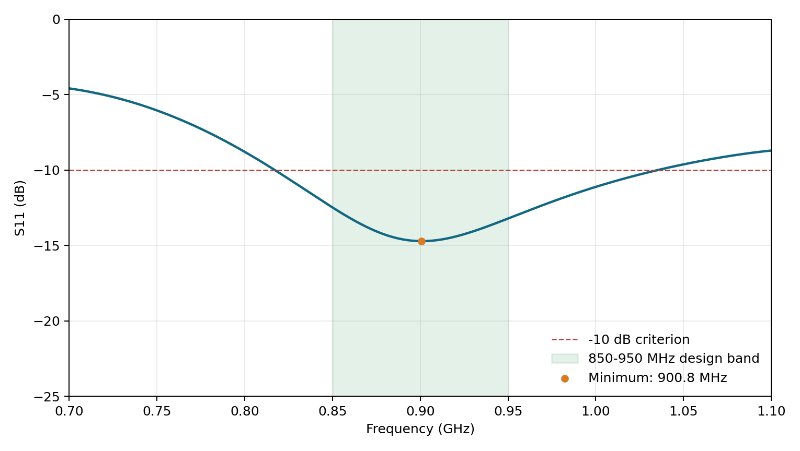

# Half-Wave Dipole Antenna

A linearly polarized, center-fed half-wave dipole designed around 900 MHz. The electromagnetic model includes two finite-conductivity copper tube arms, a 50 Ω RG-58 feed line, and a quarter-wave copper sleeve balun.

> **Model status:** The values and plots below are CST full-wave simulation results, not physical prototype measurements. The coax braid is represented as a continuous conductive shell, and the dielectric properties are nominal assumptions. Confirm the cable datasheet and verify the assembled antenna with a calibrated VNA before relying on its performance.

## Contents

- [Design at a glance](#design-at-a-glance)
- [Intended applications](#intended-applications)
- [Feed and balun](#feed-and-balun)
- [Design theory and equations](#design-theory-and-equations)
- [Materials and geometry](#materials-and-geometry)
- [Simulation setup and results](#simulation-setup-and-results)
- [Fabrication and assembly](#fabrication-and-assembly)
- [Prototype verification](#prototype-verification)
- [Model limitations](#model-limitations)
- [Repository files](#repository-files)
- [References and sourcing](#references-and-sourcing)

## Design at a glance

| Parameter | Design value |
|---|---:|
| Antenna type | Center-fed, linear half-wave dipole |
| Design center | 900 MHz |
| Intended evaluation band | 850–950 MHz |
| Simulated −10 dB return-loss interval | 817.2–1035.2 MHz |
| Radiator material | Annealed copper, finite conductivity |
| Radiator geometry | Two tubes, each 20 mm OD × 1 mm wall × 69.0 mm long |
| Feed gap | 2.0 mm |
| Tip-to-tip span | 140.0 mm |
| Feed | 50 Ω RG-58 coax, perpendicular to the dipole axis |
| Balun | Copper sleeve, 8 mm OD × 6 mm ID × 83.3 mm active length |
| CST frequency sweep | 700–1100 MHz, 1001 points |

The two arms are equal in length and extend in opposite directions along the dipole axis. The coax leaves the center of the antenna perpendicular to that axis. Keep the feed and sleeve centered and straight, and keep nearby metal and dielectric supports away from the radiating elements during initial measurements.

## Intended applications

This antenna is suitable as a compact RF laboratory and prototyping example for:

- teaching dipole current distribution, resonance, impedance, polarization, and radiation patterns;
- receiving signals with SDR equipment where the frequency is appropriate;
- VNA experiments on coaxial feed transitions, common-mode current, and sleeve baluns;
- a starting point for a low-power communication link after the operating frequency, power, equipment approval, and local spectrum rules have been confirmed.

The 850–950 MHz interval is a **design and evaluation band**, not a statement that transmission is license-free. Spectrum allocations and permitted power depend on country, service, and equipment. Check the applicable national rules before transmitting.

## Feed and balun

This is a balanced radiator fed by an unbalanced coaxial line. At the 2 mm center gap:

1. The coax center conductor connects to one dipole arm.
2. The coax braid connects to the opposite arm.
3. The copper sleeve surrounds the coax near the feed point. Its near end is bonded electrically around the braid; its far end is open.

The sleeve is a quarter-wave choke. It presents a high impedance to current on the outside of the coax, reducing feed-line radiation and helping preserve the dipole’s intended pattern. It does not remove all common-mode current in every installation; cable routing, nearby objects, connector details, and the actual coax construction still matter.

For the model, the RG-58 conductors and dielectrics run from the feed region to a 50 Ω reference port. The center conductor is 0.90 mm in diameter, the PE dielectric has 2.95 mm OD, the braid is an equivalent conductive shell with 3.60 mm OD, and the PVC jacket has 4.95 mm OD. The cable is routed perpendicular to the dipole axis.

## Design theory and equations

GitHub supports LaTeX in fenced math blocks. Each display equation below is kept as one mathematical expression so Markdown cannot reinterpret a leading minus sign as a list marker.

### Wavelength and first-cut dimensions

The free-space wavelength and wavenumber are

```math
\lambda_0 = \frac{c}{f}, \qquad k_0 = \frac{2\pi}{\lambda_0}
```

where \(c \approx 299\,792\,458\ \text{m/s}\) is the speed of light and \(f\) is frequency.

At 900 MHz,

```math
\lambda_0 \approx 333.1\ \text{mm}, \qquad \frac{\lambda_0}{2} \approx 166.6\ \text{mm}, \qquad \frac{\lambda_0}{4} \approx 83.3\ \text{mm}
```

The 83.3 mm sleeve length is close to a free-space quarter wavelength at 900 MHz. The sleeve's electrical length also depends on its geometry, the coax, end effects, and nearby materials, so this is a nominal starting dimension, then evaluated in the complete model.

Each physical dipole arm is 69.0 mm long, with a 2.0 mm feed gap, giving 140.0 mm tip-to-tip. This is shorter than the ideal thin-wire half-wavelength. Conductor diameter, feed structure, and end effects shift resonance; therefore, \(\lambda_0/2\) is a first estimate, not the tube cut length.

### Current distribution and radiation pattern

For an ideal, thin, center-fed dipole close to half-wave resonance, the sinusoidal current approximation is

```math
I(z) \approx I_m \sin\!\left[k_0\left(\frac{L}{2}-|z|\right)\right], \qquad |z| \leq \frac{L}{2}, \qquad L \approx \frac{\lambda_0}{2}
```

Here \(L\) is the total dipole length, \(z=0\) is the feed point, and \(I_m\) is the peak feed current for the half-wave approximation. Current is greatest at the feed and falls toward zero at the open ends. This is an ideal thin-wire distribution; it is not the computed current distribution of the thick-tube CST model.

For an ideal thin dipole with sinusoidal current, the normalized far-field angular factor is

```math
F(\theta) = \frac{\cos\!\left(\frac{k_0L}{2}\cos\theta\right) - \cos\!\left(\frac{k_0L}{2}\right)}{\sin\theta}
```

The subtraction in the numerator is intentional. When \(L=\lambda_0/2\), so that \(k_0L/2=\pi/2\), the expression becomes

```math
F(\theta) = \frac{\cos\!\left(\frac{\pi}{2}\cos\theta\right)}{\sin\theta}
```

The angle \(\theta\) is measured from the dipole axis. The ideal pattern has maximum radiation broadside to the wire and nulls along its axis. The electric field is polarized parallel to the arms. These are ideal thin-wire, free-space expressions; the thick tubes, coax, sleeve, and nearby environment are represented more appropriately by the full-wave model.

### Input match and return loss

For reference impedance \(Z_0\), the complex reflection coefficient is

```math
\Gamma = \frac{Z_{\mathrm{in}}-Z_0}{Z_{\mathrm{in}}+Z_0}
```

The S11 magnitude in decibels and the positive return loss are

```math
S_{11,\mathrm{dB}} = 20\log_{10}|\Gamma|, \qquad \mathrm{RL}_{\mathrm{dB}} = -20\log_{10}|\Gamma| = -S_{11,\mathrm{dB}}
```

The voltage standing-wave ratio is

```math
\mathrm{VSWR} = \frac{1+|\Gamma|}{1-|\Gamma|}
```

An S11 threshold of −10 dB means \(|\Gamma| \approx 0.316\), \(\mathrm{RL}=10\ \text{dB}\), and \(\mathrm{VSWR} \approx 1.92\). At 900 MHz, the simulated input impedance is \(48.63+j18.39\ \Omega\); the positive imaginary part is inductive reactance, so the input is not purely resistive at that frequency.

As a small-change trend, resonant frequency varies approximately inversely with effective electrical length:

```math
\frac{\Delta f_r}{f_r} \approx -\frac{\Delta L_{\mathrm{eff}}}{L_{\mathrm{eff}}}
```

Shortening both arms equally generally raises resonance; lengthening them equally generally lowers it. This relation is only a tuning guide for small changes, not a prediction formula for this thick, fed structure. Adjust symmetrically in small increments and remeasure.

## Materials and geometry

| Part | Nominal specification | Notes |
|---|---|---|
| Dipole arms (2) | Copper tube, 20 mm OD × 1 mm wall, 69.0 mm long each | 18 mm nominal ID; deburr cut ends and keep both arms equal |
| Feed gap | 2.0 mm | Maintain a centered gap and prevent the arms from touching |
| Coaxial feed | 50 Ω RG-58 | Confirm the purchased cable's dimensions and dielectric data against the model |
| Sleeve balun | Copper tube, 8 mm OD × 1 mm wall, 83.3 mm active length | 6 mm ID nominally; one end bonded to braid, opposite end open |
| Center conductor insulation | PE, nominal \(\epsilon_r=2.25\), \(\tan\delta=0.0004\) | Simulation assumptions; use the cable manufacturer's data when available |
| Outer cable jacket | PVC, nominal \(\epsilon_r=3.2\), \(\tan\delta=0.01\) | Simulation assumptions; use the cable manufacturer's data when available |

The simulation uses annealed copper with finite conductivity for the metal. No perfect electric conductor boundary/material was assigned to the antenna conductors.

The sleeve should fit around the cable jacket while maintaining electrical clearance from the dipole arms except at its intended braid bond. The final mechanical attachment method, strain relief, connector, and support dielectric are not fixed by the electromagnetic model; choose them for the prototype and include them in a subsequent simulation or measurement.

## Simulation setup and results

The CST model covers 700–1100 MHz with 1001 frequency samples, approximately 118,296 mesh cells, and expanded-open boundaries on all six sides.

| Result | Simulated value |
|---|---:|
| Minimum S11 | −14.71 dB at 900.8 MHz |
| Simulated −10 dB interval | 817.2–1035.2 MHz |
| S11 at 850 MHz | −12.48 dB |
| S11 at 900 MHz | −14.71 dB |
| S11 at 950 MHz | −13.21 dB |
| Input impedance at 900 MHz | \(48.63 + j18.39\ \Omega\) |
| Radiation efficiency at 900 MHz | 98.15% |
| Total efficiency at 900 MHz | 94.83% |

The simulated −10 dB interval contains the 850–950 MHz evaluation band. The efficiency values are solver outputs for the modeled geometry and assumed material properties; they are not measured efficiency figures and do not include omitted connector, fixture, installation, or environmental losses.



## Fabrication and assembly

1. **Check the stock.** Measure the actual copper tube diameters and wall thickness. Check the RG-58 datasheet for impedance, center-conductor diameter, dielectric, braid, jacket, and velocity factor. Replace nominal simulation material assumptions with vendor data when available.
2. **Cut the radiator tubes.** Cut two 69.0 mm pieces from 20 mm OD × 1 mm wall copper tube. Deburr the ends. Measure both pieces; their lengths should match.
3. **Prepare the feed.** Strip the coax only far enough to make the center and braid connections. Keep the exposed conductors short and mechanically stable. Preserve the 2.0 mm gap between the dipole arms.
4. **Connect the arms.** Connect the coax center conductor to one arm and the braid to the other. Keep the feed centered and avoid a long pigtail that changes the modeled feed geometry. Insulate the joint without bridging the two arms.
5. **Cut and position the sleeve.** Cut the copper sleeve to 83.3 mm active length. Position it coaxially around the feed cable, with its closed/bonded end at the feed region and its distal end open. Maintain the intended clearance to the dipole arms.
6. **Bond the sleeve to the braid.** Make a low-resistance, circumferential 360° connection at the sleeve's feed end. Do not connect the sleeve's open end to the braid or to a dipole arm.
7. **Route and secure the cable.** Route the coax away from the antenna center perpendicular to the dipole axis. Use a low-loss, low-permittivity support and keep the first section of cable straight. The support and connector were not part of the CST model.
8. **Inspect the assembly.** Confirm arm symmetry, feed-gap clearance, sleeve length and orientation, no unintended shorts, and sound electrical joints. Record any deviations from nominal dimensions.
9. **Measure before use.** Connect a calibrated 50 Ω VNA at the intended reference plane and follow the verification procedure below. Do not infer prototype performance from the CST plot alone.

Use fabrication methods appropriate for copper tubing and coaxial cable. Avoid heating the coax dielectric or jacket enough to deform it, and provide strain relief so the feed joint does not carry cable tension.

## Prototype verification

1. Calibrate the VNA at the cable end or apply a documented port extension to the antenna feed reference plane.
2. Sweep 700–1100 MHz and save the complex S11 data as an .s1p file, including calibration plane, cable, and fixture details.
3. Check that the measured S11 is below −10 dB throughout the intended 850–950 MHz evaluation band.
4. If the resonance is offset, inspect the feed joint, arm equality, sleeve bond and cable routing before adjusting dimensions. Make symmetric arm changes only, and keep a record of every cut.
5. Repeat the measurement in the intended mounting environment. A nearby mast, enclosure, person, ground plane, or support can change the match and pattern.
6. For pattern or gain measurements, use a suitable calibrated range or chamber, known antenna polarization, and a documented reference antenna and distance.

A good input match alone does not prove the expected radiation pattern, gain, efficiency, or common-mode suppression. Those require separate measurements or validated simulations.

## Model limitations

- The braid is modeled as a continuous conductive shell, not as the woven strands of a real cable.
- PE and PVC dielectric parameters are nominal model values unless confirmed for the selected cable.
- The connector, solder/braze details, support, mount, nearby structures, and installation environment are omitted.
- The plotted response and efficiency are numerical predictions. Measurement may differ because of construction tolerances and the omitted details above.
- The uploaded NX part is a manufacturing geometry reference. Its coax-layer start positions and feed-joint detail should be checked against the CST geometry before using it to release fabrication dimensions.

## Repository files

- [HWD_CST.cst](HWD_CST.cst) — CST electromagnetic model.
- [HWD_Manufacturing.prt](HWD_Manufacturing.prt) — NX native manufacturing geometry reference.
- [HWD_S11.png](HWD_S11.png) — simulated S11 plot.

## References and sourcing

- C. A. Balanis, *Antenna Theory: Analysis and Design*, 3rd edition, §9.7.6, coaxial-feed imbalance and sleeve balun.
- [HUBER+SUHNER RG-58 50 Ω cable datasheet](https://www.mouser.com/datasheet/3/1498/1/H%2BS_RG_58_CU_EN.PDF) — compare the selected cable's actual construction with the model.
- [UCI copper tube catalogue](https://www.uci.com.tr/storage/app/media/Kurumsal/urun_pdf/duzbakirTR.pdf) — dimensional catalogue reference.
- [20 × 1 mm copper tube listing](https://metaldeposu.com/urun/bakir-boru-cap-20mm-et-kalinligi-1mm/) and [8 × 1 mm copper tube listing](https://www.bhbuyukhidrolik.com.tr/bakir-boru-ic-cap-8-mm-kalinlik-1-mm-8x1-) — examples of Turkish supplier listings; confirm current stock, material, and dimensions before ordering.
- [RG-58 product listing in Türkiye](https://bisifir.com.tr/products/beespeed-rg58-koaksiyel-kablo-50-ohm-rf-telsiz-wifi-anten) — verify the supplied cable datasheet and construction before using it for this design.

For LaTeX in GitHub Markdown, see [GitHub's mathematical expressions guide](https://docs.github.com/en/get-started/writing-on-github/working-with-advanced-formatting/writing-mathematical-expressions).
